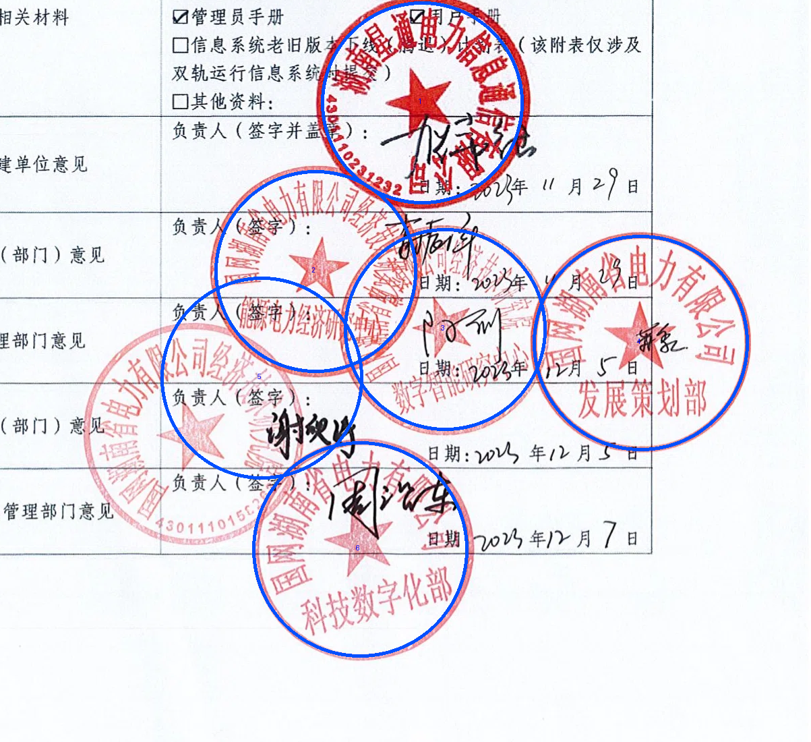
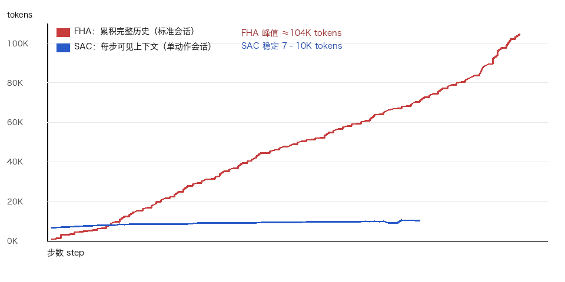
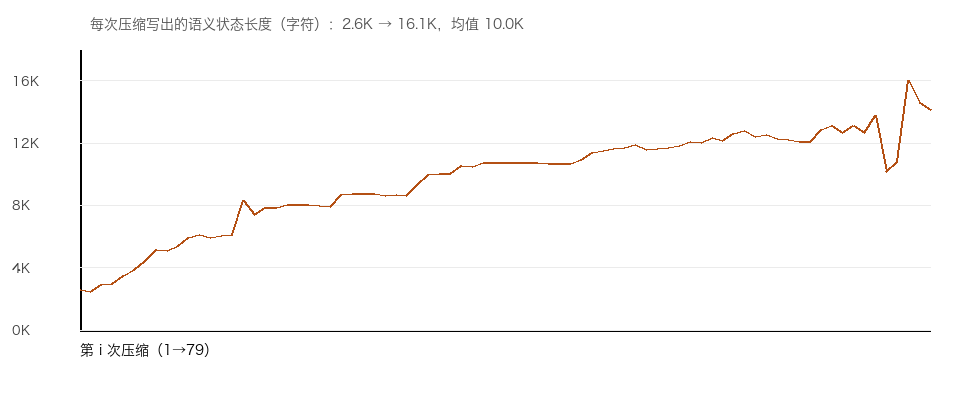

# SAC 在「二期申请单印章计数」上的作用、影响与致错机理

> 分析对象：同一份扫描件、同一个模型（`deepseek-v4.1-flash`）、同一个问题，在两个工作区里各跑了一次。
>
> | 工作区 | 会话 | 预设 | 结果 |
> |---|---|---|---|
> | `/Users/jtome/Downloads/单动作测试` | `session-57e16f8a`（标题「查询二期申请单印章」） | `sac`（单动作压缩） | **5 枚（错）** |
> | `/Users/jtome/Downloads/DeepSeek_Harness_Draft` | `session-7739901c`（标题「文件印章数量与类型」） | `standard`（全历史） | **6 枚（对）** |
>
> 本文先复核地面真值，再用会话日志逐条量化 SAC 的作用，最后给出 5 条致错机理与 7 个优化方向。第二部分（优化实现、三轮迭代与测试）见 [`REPORT-3-test.md`](REPORT-3-test.md)。

---

## 0. 结论摘要

1. **地面真值是 6 枚**（5 个不同单位/部门，经研院盖了两次）。SAC 会话答 5 枚，且 5 枚的"位置"和它自己检测到的 5 个圆心**并不对应**——它用"5 个审批栏 ⇒ 每栏 1 枚"的规则把检测结果强行对齐了。
2. SAC 的作用是**把"每步唯一的记忆"交给一段由通用模板生成的摘要**。在这类"证据密集、需要反复看图"的任务上，这等于把不可替代的观测换成可丢失的文本。
3. 致错不是单点，而是一条链：**早期假设（5）被写进状态 → 状态是唯一记忆 → 摘要自我复制 79 代 → 反证被记录但不改变结论 → 最后用阈值化的代理指标（Hough 强响应=5）把疑问"关闭"**。
4. 代价同样可观：79 次压缩、**594K 摘要 token**、**56 分钟纯压缩耗时（占墙钟 53%）**、16 次重复动作、8 次 `read_image` + 2 次渲染（共 10 个图像结果；对照组 45 次 `read_image`）。
5. 另一个被忽略的事实：预设里写了 `statePrompt: paper`，但会话里的摘要 **100% 是 DSH native 的 8 段模板**——paper 模板没有生效（静默降级）。"唯一记忆"恰好由一份**为"保留全历史 + 打 checkpoint"设计、且要求用英文写**的模板生成。

---

## 1. 事实基线

### 1.1 文档

| 项 | 值 |
|---|---|
| 文件 | `平台二期上线试运行申请单.pdf`，495,544 B，PDF 1.7，1 页 |
| 内部结构 | 单个 `/DCTDecode` 图像 XObject，1646×2331，`/Font count 0` → **纯扫描栅格，无矢量文字** |
| 可读性上限 | 200 DPI 渲染 1653×2339，与嵌入 JPEG 几乎等分辨率 |
| 审批栏 | 承建单位意见（11-29）、建设单位（部门）意见（12-02）、专业管理部门意见（12-05）、运维单位（部门）意见（12-05）、数字化职能管理部门意见（12-07） |

### 1.2 地面真值复核（6 枚）

我用 200 DPI 渲染图做了独立的圆检测 + 逐枚放大读环文，得到 6 个**各自带五角星**的印章中心：

| # | 圆心（200 DPI） | 印章 | 所在审批栏 |
|---|---|---|---|
| 1 | (1076,1152) | 湖南经研电力设计有限公司 | 承建单位意见 |
| 2 | (918,1402) | 国网湖南省电力有限公司经济技术研究院 | 建设单位（部门）意见 |
| 3 | (1110,1488) | 国网湖南省电力有限公司经济技术研究院·**数字智能研究中心** | 专业管理部门意见 |
| 4 | (1400,1508) | 国网湖南省电力有限公司·**发展策划部** | 专业管理部门意见 |
| 5 | (838,1560) | 国网湖南省电力有限公司经济技术研究院 | 运维单位（部门）意见 |
| 6 | (984,1814) | 国网湖南省电力有限公司·**科技数字化部** | 数字化职能管理部门意见 |




**关键点：专业管理部门意见这一栏有 2 枚章**（数字智能研究中心 + 发展策划部），而经研院本体章出现了 2 次（建设单位、运维单位）。所以"5 个审批栏 ⇒ 5 枚章"这个直觉规则是错的——它正是 SAC 会话最终采用的规则。

### 1.3 两个会话的量化对照

| 指标 | SAC（单动作测试） | 标准（Draft） |
|---|---|---|
| 结果 | **5 枚（错）** | **6 枚（对）** |
| 墙钟 | 13:08:39 → 14:54:45（**106 min**） | 00:21:25 → 00:55:46（**34 min**） |
| 步数 | 83 | 104 |
| 工具调用 | 111（bash 71 / read 22 / read_image 8 / office_render 4 / write 3） | 106（bash 54 / **read_image 45** / glob 1 / web_fetch 3） |
| 压缩次数 | **79** | 0 |
| 完全重复的调用 | **16 次**（同一文件 `read` 9 次） | **0 次** |
| 峰值可见上下文 | ≈9.7K tokens（稳定 6.8–9.7K） | ≈104K tokens（线性增长） |
| 摘要 token 开销 | 输入 330,544 + 输出 263,853 = **594K** | 0 |
| 纯压缩耗时 | **3,372 s（56 min，占 53%）** | 0 |
| 摘要长度 | 2.6K → 16.1K 字符，均值 10.0K | — |



**SAC 确实把每步上下文压到了 1/10，但它为此付出了比对照组全部历史还多的摘要 token，并把一半以上的墙钟花在压缩调用上。**

---

## 2. SAC 会话的解剖

### 2.1 每步模型到底看得见什么

SAC 的每一次压缩都把"任务消息之后"的区间替换成一段 checkpoint，并在下一步重新注入运行时快照与技能目录。于是**每一步的请求**是：

```
system(6,152 字符) + task + <compacted-summary>(2.9K–16.1K 字符)
+ runtime-context(953) + skill-catalog(1,635) + time-context(262) + 工具 schema
```

固定开销就有 9,002 字符（≈2.6K tokens），而**历史只剩那一段摘要**。会话里 248 条 `user/message` 中，79×3 条是这种"重放"（checkpoint + 运行时 + 技能目录），不是用户真的说了什么。

### 2.2 79 次压缩的形态

- 压缩区间是**连续的、互不重叠**的：`10-22, 26-34, 38-47, … 1186-1194`，每次 5–12 个事件，正好是"一个动作组"。
- 每次压缩都是一次**独立的 LLM 调用**：输入平均 4.2K tokens、输出平均 3.3K tokens。
- 状态本身**单调膨胀**：2.6K → 16.1K 字符（下图）。也就是说，SAC 并没有把"状态"压小，而是把"历史"换成了"越来越长的历史摘要"。



### 2.3 摘要内容的漂移：第 9 代就把结论写死了

第 9 次压缩（覆盖 step≈10–11，刚看完 200 DPI 整页）的摘要里已经出现：

> `Count currently appears to be 5; confirm no faint additional impression was missed (notably near 建设单位/专业管理部门 overlap where seals cluster).`

从这一刻起，**"5" 成为状态里的既定事实**，而"要确认有没有第 6 枚"只是一句待办。此后 70 步，摘要里反复出现 "five"，并在 `Critical Context` 里固化成一条**规则**：

> `Document has five approval blocks (…) → one seal per block → 5 seals, matching the visual read.`

第 75–76 代摘要（看完 row_01…row_05 五张行切图之后）其实**记录下了反证**：

> `row_05.png … 印章：左侧大圆…；顶部中央弧文 "数字智能部"；右上大印章 "发展策划部"；底部中央印章…`
>
> `Discrepancy to resolve: … Total red ink is 108214 px; at ~14k red px per seal that would suggest ~7–8 impressions before overlap loss, so a Hough-based center count is needed before finalizing.`

它甚至自己算出"红墨总量暗示 7–8 枚"，但**结论仍然是 5**——因为状态里的规则（一行一印）比新观测更"权威"。

### 2.4 结论是怎么被"关闭"的：阈值化的代理指标

第 81 步跑圆检测，输出 23 个候选圆心：

- **强响应 5 个**（score 167–180）：`(1076,1152) (918,1402) (1110,1488) (1400,1508) (984,1814)`
- **弱响应 18 个**（score 51–89），其中 `(838,1560)` score=59 —— **这正是第 5 枚（运维单位的经研院章）**。

脚本的保留阈值是 `0.72 × max`，于是第 6 枚被归入"弱响应"。模型在最终答案里用一句话把它们判死：

> `其余 18 个弱响应（评分 51–89）均落在手写签名和表格文字上，属于误检。`

但请注意：它检测到的 5 个强响应**并不是每行一个**（专业管理部门一行有 2 个：`(1110,1488)` 与 `(1400,1508)`；运维一行 0 个）。最终答案却写成"每栏 1 枚"，并把 `(1110,1488)` 那枚（数字智能研究中心）安到了"运维单位"栏。**位置证据与叙述矛盾，但状态里已经没有位置证据可以对照了。**

### 2.5 动作重复：状态没有记住"我已经做过"

- 同一个文件 `read` 了 **9 次**（同一段 offset 重复 3 次）；
- `ls -la` 类命令在 step 17–66 之间反复出现；
- 16 次完全重复的调用（对照会话为 0）；
- 看图 8 次，其中 step 77 把 `row_01/row_02` 又看了一遍——**说明它知道自己"应该看过"，但状态里没有"看到了什么"**。

这不是模型笨，而是 SAC 的结构性后果：每一步都是从"任务 + 摘要"重新开始，**动作历史只以摘要里的只言片语存在**，于是"做过/没做过"必须靠猜。

---

## 3. 致错机理（五条链 + 一条配置问题）

### M1 状态即全部记忆 → 早期假设被固化为事实

SAC 的设计前提是"每步只带任务 + 语义状态"。于是**第 9 代摘要里的 "appears to be 5" 就成了后续 70 步的先验**。人类的"我再确认一下"在 SAC 里不是工作记忆，而是一句会被下一次摘要重写、淡化、甚至删除的文本。

**证据**：79 代摘要中，"5" 从第 9 代出现后从未被"6"替换；第 76 代明明写了"7–8 枚"的怀疑，`Next Step` 仍然是"最终确定计数（当前为 5）"。

### M2 观测被摘要替代 → 图像证据不可回溯

看图是**不可压缩的观测**：模型看到的是像素，摘要写出的是文字。压缩后：

- 图像块被丢弃，只剩"row_05 有左侧大圆/数字智能部/发展策划部"这种**转述**；
- 转述没有坐标、没有数量、没有"我数到几个星"；
- 想复核就必须**重新花一步去看图**，而重新看图的结果又要经过下一次压缩。

对照会话看了 **45 次图**、0 次压缩；SAC 只看了 8 次 `read_image`（加 2 次渲染共 10 个图像结果）、却做了 79 次压缩。**在视觉计数任务上，SAC 把最关键的证据变成了最容易丢失的东西。**

确定性回放（`harness/replay_probe.py`，不调用模型，直接按会话事件重建每一步的可见表面）给出了更硬的数字：

```
events=1209 compactions=79 image_results=10
final surface: 770 seqs
image results still in context, plain SAC: 0/10
image results kept with pinImages=6: 6/10 (seqs >= 1098)
distinct actions=95 repeated_calls=16 at steps [4,28,31,33,42,45,48,52,53,55,58,59,64,77]
```

也就是说：**在给出最终答案的那一刻，模型上下文里 10 次图像观测一个都不剩**；如果按 v10 的"最近 6 次图像观测不折叠"策略，则能留下 6 个。同一份日志还显示 16 次重复动作——账本可以把它们全部标出来。

### M3 摘要的 79 代自复制 → 漂移、膨胀、语言转换

native 模板明确要求："If the conversation already contains a `<compacted-summary>` block, it is a PRIOR checkpoint. Do not copy it forward verbatim: preserve still-true facts, drop stale ones, and merge newer information"。

于是每一代都是"对上一代摘要的再摘要"。后果有三：

1. **漂移**：第 1 代摘要甚至写 "No explicit user request has been stated yet"（用户请求早已存在），说明单代摘要本身就会幻觉；
2. **膨胀**：为了"不丢信息"，摘要越写越长（2.6K→16.1K 字符），SAC 的上下文优势被自己吃掉一部分；
3. **语言/术语转换**：模板要求 "Write concise English engineering prose"，中文印章名被英文转述，出现 "数字智能部"（实际是"数字智能研究中心"）、"…电力有限公司…经济研究院"这类模糊化。

### M4 状态里的"计数规则"压过证据

第 75 代摘要同时包含：

- 证据：row_05 里有"数字智能部"和"发展策划部"两处弧文；
- 规则：五个审批栏 → 每栏一枚 → 5 枚。

**规则赢了。** 原因是状态是"叙述"而不是"证据表"：叙述里规则和事实平权，而规则更简洁、更符合直觉，下一代会优先保留它。最终答案的表格结构（一行一枚）就是这条规则的直接产物。

### M5 代理指标阈值化 → 把"没找到"当成"不存在"

当视觉证据不可用时，模型退而使用机器指标（Hough 圆检测）。这本身是合理的，但：

- 阈值 `0.72×max` 是**为了压掉噪声**设的，它对"被遮挡/叠压的第 6 枚"系统性不友好；
- 弱响应被一句话判为"签名/表格线误检"，**没有逐条核对**（它已经无法核对：图像不在上下文里）；
- 5 个强响应与"5 行"数字相同，产生**虚假印证**，掩盖了位置不匹配。

**"指标同意"被当成了"证据同意"。**

### M6 配置静默降级：paper 模板没生效

`plugins/dsh-sac-preset/cordis.patch.yml` 里写的是：

```yaml
- id: sac-compact
  config:
    statePrompt: paper
    stateMaxTokens: 2048
```

但会话里 79 段摘要的结构 **100% 是 DSH native 的 8 段模板**（`## Primary Request and Intent` / `## Key Technical Concepts` / … / `## Critical Context`），不是 paper 模板的 `Objective / Established facts / Applied changes / Verification / Dead ends / Remaining plan`。

也就是说 `index.js` 里的这段逻辑没有生效：

```js
if (policy.statePrompt === 'paper') {
  const engine = ctx.get('compaction')
  if (engine !== undefined && typeof engine.summarize === 'function') { engine.summarize = paperSummarize(...) }
  else ctx.logger?.warn?.('… no compaction backend …')
}
```

最可能的原因是 `ctx.get('compaction')` 在 `apply()` 时刻拿到的是 `undefined` 或另一个实例（隔离组内的服务尚未就绪），于是**静默回退到 native**。后果很严重：SAC 把"摘要"当成唯一记忆，却用了一份**为"保留全历史 + 打 checkpoint"设计、并且要求英文**的模板。

> 这一条是"实现缺陷"，不是范式缺陷，但它放大了 M1–M4。

---

## 4. 对照：为什么标准会话答对了

| 行为 | 标准会话 | 意义 |
|---|---|---|
| 看图 45 次 | 反复放大、极坐标展开环文、标注复核 | 观测始终在上下文里，可增量累积 |
| 0 次重复调用 | 每步都在推进 | 动作历史完整，不需要"重做一遍确认" |
| 显式找"隐藏的第 6 枚" | step 93 输出 `best in hidden-seal region: (0.4736, 1424, 2514, 190)` | 把"可能漏"当成假设去验证，而不是当成待办 |
| 产出标注图 | `平台二期试运行申请单_印章标注.png`，6 个圈 | 结论可自检、可交付 |

代价是 104 步、峰值 ≈104K tokens。**在 1M 窗口下这是可接受的；SAC 的收益是上下文，但在这类任务上它把"可复核的证据"换成了"不可复核的叙述"。**

---

## 5. 优化方向

按"是否触及根因"排序，并标注落地版本（v10–v12 在第二轮实现并测试）。

| # | 方向 | 针对机理 | 做法 | 版本 |
|---|---|---|---|---|
| D1 | **机器账本**（确定性、不过 LLM） | M1/M2/M5 | 每次工具调用写一条 `(step, tool, args, 结果摘要)`；图像记 `path+尺寸+sha+已看`；账本每步前置且**永不参与摘要** | v10 |
| D2 | **观测钉住**（observation pinning） | M2 | 含图像的工具结果**不进入可折叠区间**；折叠时只替换为"路径 + 尺寸 + 你当时的结论"，保证随时可零成本重看 | v10 |
| D3 | **重复动作守卫** | M1/M3 | 下一次调用与账本中某条完全相同时，注入 `[already done at step N → 结果摘要]`，禁止"失忆式重做" | v10 |
| D4 | **结构化累积状态** | M3/M4 | 状态改为固定 schema（目标/已验证事实+出处/开放问题/下一步），**增量更新**而非"摘要的摘要"；事实只增不删，除非被新证据显式推翻 | v11 |
| D5 | **证据门控** | M4/M5 | `finish` 前必须为每个子目标登记 `claim + evidence(step/tool)`；未登记则拒绝结束并提示补证 | v11 |
| D6 | **代理指标溯源 + 矛盾检查** | M5 | 任何"由指标得出的数字"必须记录 `指标/阈值/排除了什么/独立复核`；同一主题出现两个不同数字时标记 CONTRADICTION，禁止用同一指标"关闭" | v12 |
| D7 | **配置自检** | M6 | 启动时校验 `statePrompt` 是否真正挂上（挂不上就报错而不是静默降级）；把"状态模板"纳入会话可观测项 | v10 |

### 5.1 为什么这些方向能对症

- D1+D2 让"看过什么"变成**确定性的、可回溯的事实**，而不是模型自己的转述；
- D3 直接消除"每步重新开始"导致的重复劳动（本次 16 次重复调用、9 次重读同一文件）；
- D4 把"叙述"换成"证据表"，让 M4 里"规则压过证据"失去结构基础；
- D5 把"我数完了"从**自我声明**变成**可检查的登记**；
- D6 让"阈值=5"必须附带"排除了什么、有没有第二种方法"，并阻止用同一个指标关掉矛盾。

### 5.2 不应做的优化

- **不要简单提高压缩阈值/减少压缩次数**：那只是把 SAC 退化成 EoCC，治标不治本；
- **不要把状态写得更长**：本次摘要已经从 2.6K 涨到 16.1K 字符，仍然答错——问题不在长度，在**结构**；
- **不要禁止使用检测脚本**：代理指标本身有价值，问题是没有溯源与交叉验证。

---

## 6. 边界与诚实声明

1. 本分析基于两个**真实会话日志**（`~/.dsh/sessions/…/session.v4.jsonl.zstd` 解压后逐事件解析），不是复述。
2. 地面真值由我独立复核（圆检测 + 6 张 2× 放大裁切逐枚读环文），与标准会话结论一致；SAC 的 5 与它自己的检测结果也不自洽。
3. 单次会话存在随机性；"SAC 必然答错"不成立。能成立的是：**当前 SAC 实现把"早期假设 + 不可回溯的观测"变成了系统性风险**，而本次正好命中了它。
4. 第 2、3 轮的优化实现与多种测试见 [`REPORT-3-test.md`](REPORT-3-test.md)；原始轨迹与复现脚本在 `work/` 下。